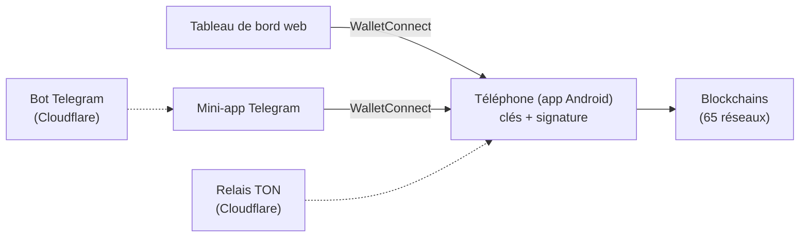
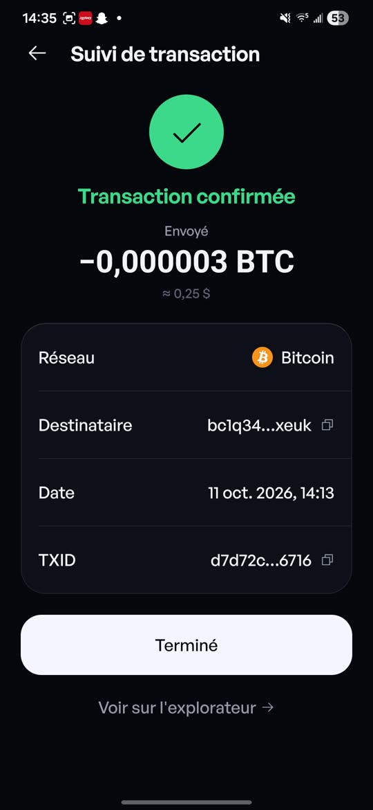
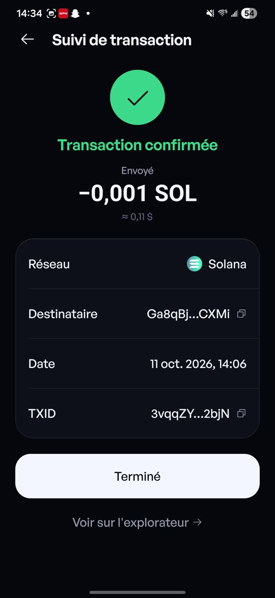
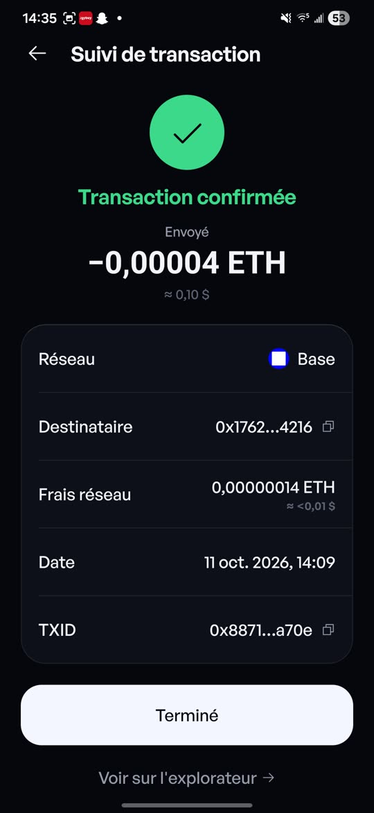
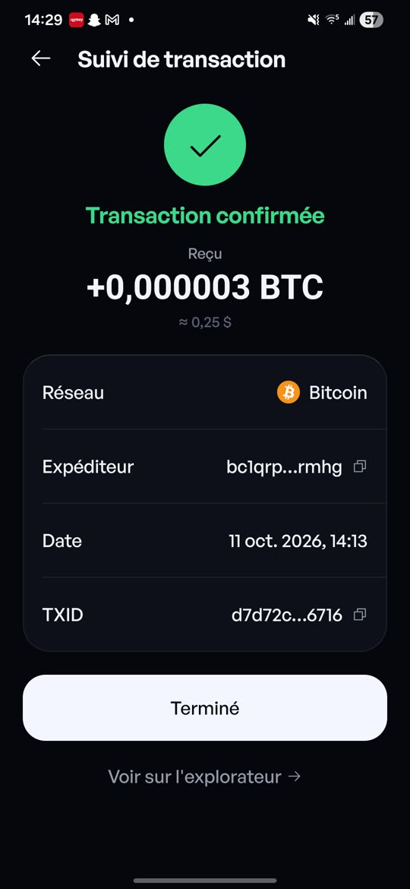
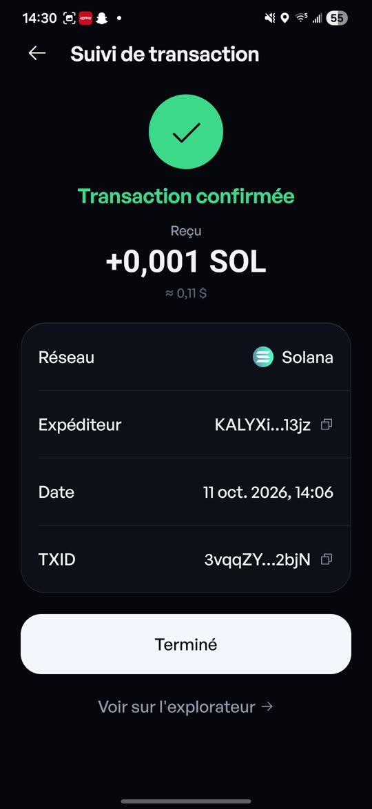
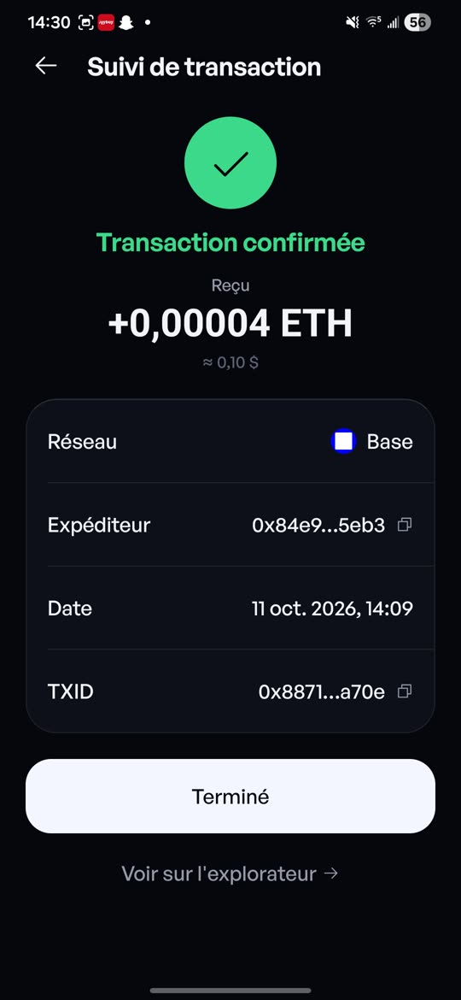

# Kalyx Wallet — Dossier de vente

9 octobre 2026 · KALYX (Ahamed Signate)

## Résumé

Kalyx Wallet est un portefeuille crypto non-custodial pour Android, livré avec un tableau de bord web, une mini-app Telegram et un bot. Il est en bêta ouverte et gratuite, publiée par une chaîne de build automatisée (release v1.0.0-8).

Ce qui est cédé : le code source complet (licence propriétaire, tous droits réservés), la marque Kalyx, le domaine kalyxwallet.com, les comptes de build et de distribution, et la documentation.

| Indicateur | Valeur |
| --- | --- |
| Réseaux pris en charge | 65 (62 EVM + Bitcoin, Solana, TON), plus 5 réseaux de test |
| Langues | 15 |
| Tests automatisés | 1 734 (tous au vert) |
| Surfaces | App Android, web, mini-app Telegram, bot Telegram |
| Revenus | Frais de 0,3 % sur les swaps ; 0 % sur envoi, réception et Earn |
| Utilisateurs, revenus à ce jour | À compléter par le vendeur |

## Produit

Un seul solde agrégé sur 65 réseaux, et chaque signature expliquée en une phrase avant d'être donnée.

| Domaine | Fonctions |
| --- | --- |
| Portefeuille | Création ou import (12 mots), plusieurs comptes, portefeuilles en lecture seule, recherche des comptes à l'import, sauvegarde chiffrée (fichier ou Google Drive) |
| Envoi | Quatre gestes (actif, destinataire, montant, maintenir 1,2 s), montant en monnaie locale, « ton solde passera de A à B », contacts |
| Échange | LI.FI et Relay (EVM, inter-chaînes), Jupiter (Solana), STON.fi (TON) |
| Earn | Aave v3, Lido, Rocket Pool, Benqi, Jito, Marinade, Tonstakers |
| dApps | Navigateur intégré, WalletConnect v2 (EVM, Solana, Bitcoin), TON Connect, révocation groupée des autorisations |
| Web et Telegram | Tableau de bord app.kalyxwallet.com et mini-app : soldes, jetons, NFT, historique filtrable, export CSV, envoi, réception, échange ; chaque signature validée sur le téléphone |
| Bot Telegram | Prix, gaz, analyse de jetons, alertes de prix |
| Copilote IA | Assistant avec la clé de l'utilisateur (OpenAI, Anthropic, Gemini, DeepSeek, Groq, OpenRouter…), désactivé par défaut |
| Réseaux de test | Sepolia, Base Sepolia, Monad Testnet, Solana Devnet, TON Testnet, hors du total |

## Sécurité

Les clés ne quittent jamais le téléphone : aucun serveur Kalyx ne détient ni ne voit une clé, et il n'y a ni compte ni télémétrie.

- **Coffre** : phrase chiffrée en AES-256-GCM, clé dérivée du PIN par scrypt, stockée dans le Keystore Android ; clés déchiffrées le temps de signer, puis effacées.
- **PIN** : délai croissant après 6 erreurs (30 s, 1 min, 5 min, 15 min, 1 h), insensible au changement d'heure.
- **Code de contrainte** : un second code ouvre un portefeuille leurre ; les vrais portefeuilles restent invisibles.
- **Liste blanche** : envois limités aux adresses approuvées ; une adresse ajoutée ou la désactivation ne prend effet qu'après 24 h.
- **Anti-Drainer** : simulation des transactions, autorisations illimitées et Permit signalés en rouge, sites vérifiés (WalletConnect Verify, GoPlus).
- **Adresses sosies** : détection de l'empoisonnement d'adresse, envoi bloqué ; étoile visuelle unique par adresse.
- **Écran** : phrase voilée, capture d'écran bloquée, flou dans les apps récentes, verrouillage automatique.

Trois audits internes successifs ont été menés (le dernier le 8 octobre 2026). Aucun audit externe indépendant n'a encore été réalisé.

## Technique

Une seule base de code TypeScript alimente l'app, le web et la mini-app Telegram ; le moteur (clés, chaînes, transactions) ne dépend pas de React.

| Élément | Détail |
| --- | --- |
| App | Expo SDK 57, React Native 0.86, expo-router, zustand |
| Moteur | `src/` : cryptographie, adaptateurs de chaînes, transactions, swap, sécurité |
| Web et Telegram | Même code (`ui/web`), signature par WalletConnect sur le téléphone |
| Site | Next.js, 15 langues (`web/`) |
| Bot et relais | Cloudflare Workers : bot Telegram (`bot/`), relais TON (`ton-proxy/`) |
| Qualité | Typage strict sans erreur, 1 734 tests, envois réels réussis sur le mainnet (Bitcoin, Solana, ETH sur Base), contrôles automatiques (fichiers interdits, usage des adresses) à chaque push |
| Livraison | Build EAS puis publication automatique de l'APK et de son empreinte SHA-256 sur un dépôt public de releases |
| Mises à jour | Aucune mise à jour à distance (pas d'OTA) : chaque version est un APK signé |

Le web et la mini-app préparent ; seul le téléphone détient les clés et signe.

## Modèle économique

Le revenu vient d'un frais de 0,3 % sur chaque échange ; l'envoi, la réception, Earn et le copilote IA ne coûtent rien à l'utilisateur.

Pistes pour un acheteur : licences en marque blanche (la licence actuelle le prévoit), frais de swap négociés avec les agrégateurs, version iOS et extension navigateur.

Chiffres à fournir avant toute offre :

- [ ] Installations et utilisateurs actifs mensuels
- [ ] Volume d'échanges et frais perçus depuis le lancement
- [ ] Coûts mensuels (clés d'API Alchemy, Helius, Etherscan, LI.FI, CoinGecko ; hébergement ; EAS)
- [ ] Communauté (Telegram @kalyxntw, réseaux sociaux)

## Ce qui est transféré

L'acheteur reçoit tout ce qu'il faut pour publier la prochaine version sans le vendeur.

| Élément | Transfert |
| --- | --- |
| Code source (dépôts kalyx-wallet et kalyx-wallet-release) | Cession des droits + transfert des dépôts GitHub |
| Marque « Kalyx », logo, design | Cession des droits d'auteur sur le design et le logo |
| Domaine kalyxwallet.com | Transfert chez le registrar avec le code d'autorisation, si le domaine est enregistré à ton nom (à confirmer : il est loué) |
| Projet Expo / EAS et sa configuration | Transfert du projet vers le compte de l'acheteur |
| Clé de signature Android | Remise sécurisée (sans elle, les mises à jour ne s'installent pas par-dessus l'app existante) |
| Bot et canal Telegram | Transfert de propriété via BotFather et Telegram |
| Workers Cloudflare (bot, relais TON) | Transfert du compte ou redéploiement |
| Clés d'API | Régénérées au nom de l'acheteur (jamais cédées) |
| Accompagnement | Passation technique, durée à négocier |

## Risques connus et feuille de route

Le principal risque pour un acheteur est l'absence d'audit externe ; le reste relève de la croissance.

| Risque | État |
| --- | --- |
| Pas d'audit de sécurité externe | À commander avant une sortie stable |
| Android uniquement | iOS et extension navigateur à venir |
| Dépendances WalletConnect anciennes (web3wallet) | Migration vers WalletKit à planifier ; la faille signalée sur `elliptic` ne touche pas l'app |
| Cadre réglementaire des frais de swap | À vérifier selon les pays visés |
| Traction | À documenter (section Modèle économique) |

Feuille de route envisagée : Lightning, coffre partagé (multisig Safe et Bitcoin), parité complète du web (Earn, révocation, TON), audit externe, publication sur le Play Store.

## Annexe : transactions réelles sur le mainnet

Trois transferts réels ont été menés le 11 octobre 2026 entre 14 h 06 et 14 h 13, d'un portefeuille Kalyx à un autre. Chaque transaction apparaît « Envoyé » d'un côté et « Reçu » de l'autre, confirmée, avec le même identifiant ; chacune est vérifiable publiquement.

| Heure | Réseau | Montant | Frais | Expéditeur | Destinataire | Transaction |
| --- | --- | --- | --- | --- | --- | --- |
| 14:13 | Bitcoin | 0,000003 BTC | — | bc1qrpwh4avxqqe0zc94q844nzey6jf0ttc8alrmhg | bc1q346y7heg9dpqdzcz9r9su2t4uw3c6lz94xxeuk | [d7d72c…6716](https://mempool.space/tx/d7d72c5a3392765d58af5af7771caaf3eeefba3b33731596c65b0a2007b76716) |
| 14:09 | Base | 0,00004 ETH | 0,00000014 ETH (< 0,01 $) | 0x84e90b03e29c28b22c645ad6c0badc9574995eb3 | 0x1762391077fad4b11f51181328244919e5d74216 | [0x8871…a70e](https://basescan.org/tx/0x88714ae5fd8b7f4480d18ef107a680bad54ce4908fca16aa8b4f0c68caf2a70e) |
| 14:06 | Solana | 0,001 SOL | — | KALYXiXBdhzuEyFuPx9EdoqyaiUcrBTT9k66v4C13jz | Ga8qBjQP4im43X48inK6rsmbTDtpYEjam1kzboonCXMi | [3vqqZY…2bjN](https://solscan.io/tx/3vqqZYnjSTwuQeT216L87WLFu8EoFBCxwsSBhx9yZEc8jCj9ygpqWpR4Tf5yJZ1LBaPX92tL7vm72DXWnGC72bjN) |

### Côté envoi

### Côté réception

